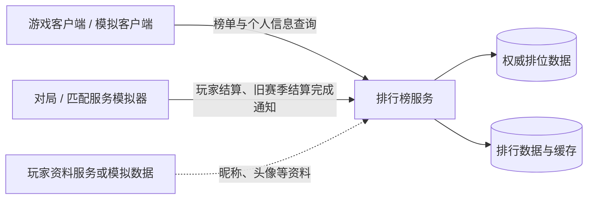
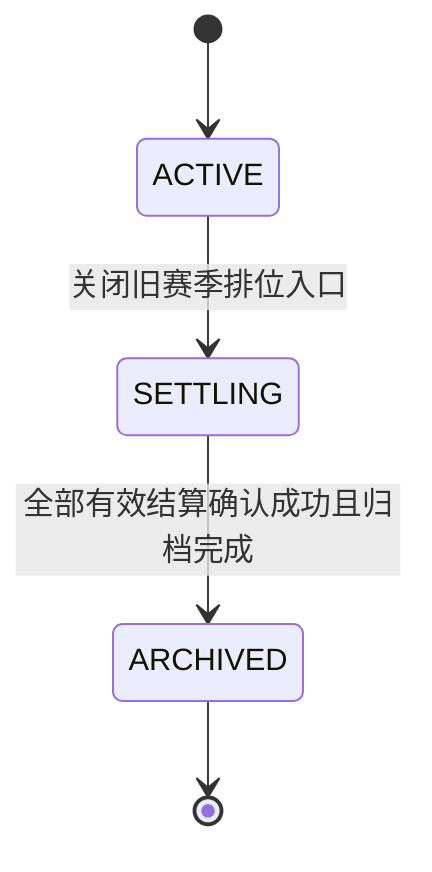

# GameLeaderboard｜需求规格说明书（SRS）

> **文档编号** GL-SRS-001 · **版本** V1.0 · **日期** 2026-11-25  
> **状态** 需求评审基线（含待确认项，尚未完成正式签核）  
> **范围** 模拟 MOBA 游戏的排位排行榜后端模块  
> **关联文档** [技术预研报告 GL-TR-001](02-technical-research.md)

本文档用于约定业务范围、行为、接口契约及验收目标，是详细设计、开发、测试和交付的依据。项目为个人模拟企业开发实践；策划、对局服务组、技术主管及 QA 均为模拟角色，不代表真实企业人员或正式商业项目。本文中的运营预测为容量规划假设，而非真实线上数据。

## 1. 文档控制与职责

| 角色 | 职责 | 评审责任 |
|---|---|---|
| 游戏策划（模拟） | 排位规则、用户体验、需求优先级 | 确认业务口径及取舍 |
| 排行榜后端负责人（项目开发者） | 需求澄清、技术设计、核心 C++ 实现 | 确认可实现性、成本与风险 |
| 对局/匹配服务负责人（模拟） | 生成对局结果、赛季准入、可靠通知 | 确认跨服务契约 |
| 客户端负责人（模拟） | 排行榜 UI、浏览交互 | 确认展示及错误处理 |
| 技术主管 / QA / 运维（模拟） | 设计评审、测试与运行保障 | 确认验收方法、异常场景 |

| 版本 | 变更 | 状态 |
|---|---|---|
| V0.1 | 初始功能、非功能需求 | 已讨论 |
| V1.0 | 整合需求评审、边界条件、跨服务协作及容量估算 | 评审基线；第 10 节待确认 |

变更流程：提出变更 → 记录业务理由、影响范围及验收调整 → 策划与后端评审 → 更新需求版本 → 同步设计与测试用例。技术选型的变更不应擅自改变已约定的业务语义。

## 2. 背景、目标与范围

通过全服排名、个人排名及历史赛季信息，帮助玩家了解竞技水平并形成长期竞技目标。第一版（MVP）聚焦单个全服排位榜及其完整结算生命周期，重点验证正确性、可靠性、热点读性能和可维护性。

**包含：** Top1000、个人排名、排位积分和胜率、比赛结算、赛季切换及归档、跨赛季段位继承、榜单分页与刷新。外围模拟对局服务及客户端可用于端到端联调和压测，但不是核心开发范围。

**不包含：** 实际游戏战斗、匹配算法、账号/头像管理、好友榜/地区榜、反作弊、奖励发放、赛季最高全服排名、连胜奖励/MVP 奖励/掉段保护。安全认证与外部系统接入细节在详细设计中明确，不能据此视为已实现。



## 3. 术语及业务数据

- `uid`：玩家唯一标识；`match_id`：比赛全局唯一标识；`season_id`：赛季唯一标识。
- 玩家结算：一场有效排位比赛中的一名玩家的一次结算。5V5 比赛产生 10 条玩家结算请求；第一版以单玩家为业务原子单位，不要求一场比赛的 10 条结算整体原子提交。
- 参与排位玩家：当前赛季至少完成一次有效排位结算的玩家。仅初始化排位记录不代表已经入榜。
- 当前积分：星数的累计整数编码，不是现实游戏的官方段位规则。
- 快照：某个榜单版本的固定排序及对应展示数据；客户端浏览版本与服务端最新版本可以不同。

## 4. 功能需求与规则

### FR-01 全服排行榜（P0）

展示当前赛季前 1000 名已参与排位玩家；不足 1000 名时展示实际人数。每条记录包含排名、UID、头像地址、昵称、段位、积分、胜率；UID 用于标识或跳转，不直接展示。积分达成时间仅用于排序。玩家资料由外围服务或模拟数据提供，来源及更新策略待详细设计。

### FR-02 个人排名（P0）

已参与排位的玩家可查询全服唯一顺序排名及前百分比。排名从 1 开始，分母为同一排行状态的当前赛季入榜玩家总数 N；百分比 = rank / N × 100%，保留两位小数、四舍五入。真实比例不足 0.01% 时显示「前 0.01% 以内」。未参与排位时不返回虚构排名；N=0 时不得除零。

个人排位主页需展示最新已成功结算的积分、段位和胜率。榜单行的积分与排序必须来自同一份榜单状态，不得将最新积分覆盖进旧榜单行。榜单底部个人信息与 Top1000 快照之间是否要求严格同版本，尚待确认（Q-01）；不得把此问题默认为已解决。

### FR-03 比赛结算（P0）

对局服务负责生成真实有效的胜负结果并确定赛季归属；排行榜服务根据该结果独立计算排位数据，不负责战斗逻辑。

- 胜利 +1 分，失败 -1 分，限制在 [0,735]；触及边界时积分保持不变。
- 每场有效排位仍增加总场次；获胜时增加胜场数，包括满分获胜。胜率由累计胜场 / 总场次计算，不在旧胜率上增减。
- 当前积分发生变化时，更新积分达成时间；不变化则保留原时间。
- 结算成功后玩家权威排位数据立即可查询；排行榜投影允许短暂延迟，见 NFR-04。
- 同一 `(match_id, uid)` 不得重复产生业务效果。重复请求应返回原始结算结果；重复请求在归档后也不能重新改变历史数据。相同标识但内容不同属于冲突，错误语义及审计处理待详细设计确认（Q-02）。
- 已确认成功的结算必须可靠保存；请求超时不代表事务失败，调用方可使用相同标识重试。

### FR-04 多条件排序与段位（P0）

采用严格的唯一顺序排名，不采用并列跳号排名。排序优先级：积分降序 → 胜率降序 → 当前积分达成时间升序 → UID 降序。胜率先按百分数保留一位小数、四舍五入，再参与排序；时间为秒级。采用最近一次达到当前积分的时间，而不是历史第一次达到该积分的时间。

| 段位 | 小段数 | 每小段星数 | 累计积分区间 | 继承最低积分 |
|---|---:|---:|---|---:|
| 黑铁 | 5 | 5 | 0–24 | 0 |
| 青铜 | 5 | 5 | 25–49 | 25 |
| 白银 | 5 | 5 | 50–74 | 50 |
| 黄金 | 5 | 5 | 75–99 | 75 |
| 铂金 | 5 | 5 | 100–124 | 100 |
| 翡翠 | 5 | 5 | 125–149 | 125 |
| 钻石 | 5 | 5 | 150–174 | 150 |
| 大师 | 3 | 10 | 175–204 | 175 |
| 宗师 | 3 | 10 | 205–234 | 205 |
| 王者 | 无 | 最多 500 星 | 235–735 | 235 |

区间采用左闭右开分段、王者上限包含 735，为整理时依据累计星数推导的口径；小段编号及星数展示格式待确认。该体系为自定义 MOBA 规则。赛季正常约三个月，技术编码设计支持最长 365 天；跨边界结算时间如何处理见 Q-03。零场次胜率及初始积分达成时间见 Q-04。

### FR-05 分页与刷新（P0）

- 每页 20 名，最多 50 页；不足一页时按实际条数返回。
- 首次打开及退出后重新进入时获取最新可用快照；浏览期间不自动刷新。
- 翻页沿用同一榜单版本，保证固定榜单中不会因实时排序变化产生重复或遗漏。
- 主动刷新获取最新快照并返回第一页。
- 快照自生成起有效 5 分钟；过期后翻页提示刷新，不静默切换版本。客户端已显示的旧页面不因服务端刷新而自动跳动。
- 服务端最新可用快照正常情况下不超过 3 秒数据滞后，不意味着用户静态浏览的页面必须每 3 秒刷新。

### FR-06 赛季生命周期及历史归档（P0）

按开赛时所属赛季结算；结束时间跨越赛季切换不改变归属。赛季切换期间暂停新排位对局，匹配/娱乐等外围玩法可继续。旧赛季结算全部完成后再开放新赛季排位，不在旧赛季未归档时临时继承段位。



| 阶段 | 对局服务 | 排行榜服务 |
|---|---|---|
| ACTIVE | 创建本赛季比赛 | 接受有效结算并更新榜单 |
| SETTLING | 停止旧赛季开赛，已有对局继续 | 仍处理旧赛季未完成的有效结算 |
| 归档处理 | 确认所有有效玩家结算成功，发送可重试通知 | 固化完整最终排名与历史数据，完成后转为 ARCHIVED |
| ARCHIVED / 新赛季开放 | 开放新赛季排位（需确认新赛季可用） | 历史榜单不再改变；新赛季独立运行 |

旧赛季结束通知不能仅以比赛已经结束为依据，必须确保所有有效玩家结算已成功。归档通知应幂等，归档未完成不得对外宣称成功；中间状态、失败恢复及跨服务开放信号在详细设计确认。

历史保存：赛季最终 Top1000；每个入榜玩家的最终排名、最终百分比、最终段位、最终积分及胜率；赛季最高段位。第一版不追踪历史最高全服排名。历史查询可展示以上已归档数据；历史保留期限、最高段位是否包含继承初始值见 Q-05。

### FR-07 新赛季段位继承（P0；由 FR-06 拆分）

| 上赛季最终段位 | 继承至 | 初始积分 |
|---|---|---:|
| 黑铁 / 青铜 | 黑铁 | 0 |
| 白银 | 青铜 | 25 |
| 黄金 | 白银 | 50 |
| 铂金 | 黄金 | 75 |
| 翡翠 | 铂金 | 100 |
| 钻石 | 翡翠 | 125 |
| 大师 / 宗师 / 王者 | 钻石 | 150 |

采用懒初始化：新赛季不批量为所有历史玩家创建记录；首次打开排位页时初始化，若未打开页面就收到首场结算，也必须确保初始化完成。胜场与总场次清零；继承到目标段位最低积分。初始化本身不入榜。并发首次访问不得产生多个独立赛季记录或覆盖已结算数据。

缺席多个赛季时逐次应用继承规则，最低为黑铁。例：S1 王者 → S2 缺席（理论钻石）→ S3 回归（翡翠，125 分）。无历史玩家的初始值、只有初始化但无对局的赛季继承口径见 Q-04。

## 5. 跨服务接口契约（逻辑草案，非最终 API 规范）

### 5.1 单玩家结算

逻辑请求示例：

```json
{
  "match_id": 202611250001,
  "uid": 10001,
  "season_id": 1,
  "is_win": true,
  "start_time": 1795618200,
  "end_time": 1795620000
}
```

时间为秒级 Unix 时间戳，示例仅说明结构。比赛开始时由对局服务确定 `season_id`，重试必须保持业务数据与标识一致。排行榜服务负责校验有效赛季及结算合法性。HTTP 路径、鉴权、ID 类型/范围、响应字段、错误码、时间来源及排序语义均由后续接口详细设计确定。

### 5.2 旧赛季全部结算完成通知

候选接口：`POST /internal/seasons/settlement-complete`，请求体 `{"season_id": 1}`。发送前置条件：已停止创建该赛季新比赛，所有有效玩家结算已确认成功。通知可重试且必须幂等。归档完成的确认机制及通知超时、失败对账流程待设计。

### 5.3 客户端接口能力

提供最新可用榜单首页、指定快照分页、个人排行、最新个人排位信息、历史赛季查询及当前赛季开放状态等能力。快照标识、响应契约及接口组合由技术设计明确。个人排名与页面快照的版本策略见 Q-01。

## 6. 容量规划与非功能需求

### 6.1 模拟运营假设与推导

| 参数 | 假设值 |
|---|---:|
| 注册玩家 / 单赛季入榜容量目标 | 100 万 |
| 高峰同时在线 | 10 万 |
| 正在进行排位的比例 | 60% |
| 对局人数 / 平均时长 | 10 人 / 20 分钟 |
| 每名在线玩家平均浏览间隔 | 600 秒 |
| 每次浏览请求 | 7 条（首页+个人排名 2，额外翻页 3，手动刷新榜单+个人排名 2） |
| 预留系数 | 5 倍，暂定规划假设 |

- 结算平均流量：60,000 / 1,200 = 50 玩家结算/秒；设计目标 250 QPS。依据稳态平均并发和平均停留时间的关系，实际瞬时流量可能集中到达。
- 查询平均流量：100,000 × 7 / 600 ≈ 1,167 QPS；5 倍 ≈ 5,833 QPS，向上取整为 6,000 QPS。
- 查询模型中榜单请求占 5/7，个人排名请求占 2/7，作为压测流量配比的初始参考；最新个人排位信息若另设独立请求需重新估算。取消了早期 5 秒/10 秒自动刷新设想，原 20,000 QPS 不再是当前基线。
- 5 倍不是行业标准，后续依据实际业务流量、重试、故障冗余及成本调整。

### 6.2 非功能指标（目标，尚未通过系统验收）

| ID | 指标 | 目标与范围 |
|---|---|---|
| NFR-01 | 容量 | 单赛季 100 万入榜玩家 |
| NFR-02 | 查询吞吐 | 6,000 QPS，含分页及个人排名 |
| NFR-03 | 查询延迟 | P99 ≤ 50 ms（在约定负载及环境下的端到端查询延迟） |
| NFR-04 | 数据时效 | 正常运行时，结算提交到最新可用榜单可见 ≤ 3 秒；成功结算后的权威个人数据可立即查询 |
| NFR-05 | 结算吞吐 | 250 玩家结算请求/秒 |
| NFR-06 | 可靠性 | 已确认成功的结算在约定故障模型内不得丢失；明确权威存储与恢复机制 |
| NFR-07 | 幂等正确性 | 同一业务结算标识最多产生一次业务效果 |
| NFR-08 | 浏览一致性 | 有效快照内翻页无重复、遗漏或排序矛盾；有效期 5 分钟 |
| NFR-09 | 可观测性（建议） | 记录查询/结算延迟、吞吐、错误、缓存命中、投影滞后及归档状态 |

目标不等于单台当前预研服务器的容量承诺。压测硬件、并发/流量模型、混合读写、持续时间、错误率阈值、结算延迟、故障范围及恢复时间目标待确认。正常 3 秒时效不应被解释为所有故障情况下的硬保证。

## 7. 验收用例与需求追踪矩阵

以下为拟定验收条件，尚未运行。QA 可据此补充输入数据与自动化脚本。

| 用例 ID | 对应需求 | 场景与预期 |
|---|---|---|
| AC-01 | FR-01/04 | 1,001 名玩家，验证前 1,000 名完整、唯一、按四级排序；不足 1,000 时正确返回 |
| AC-02 | FR-04 | 同分依次比较胜率、积分时间、UID；四舍五入后相同胜率进入下一排序条件 |
| AC-03 | FR-02 | 榜内/榜外玩家排名及百分比正确；极小百分比、无排位及空榜不出现错误数值 |
| AC-04 | FR-03 | 0 分失败与 735 分胜利仍正确更新场次；积分时间保持不变 |
| AC-05 | FR-03/NFR-07 | 相同结算重复发送、并发重试、成功后响应丢失，业务效果仅一次 |
| AC-06 | FR-05/NFR-08 | 首页与后续页之间注入排名变化，同一快照无重复遗漏；过期明确提示刷新 |
| AC-07 | FR-06 | 旧赛季跨界比赛按开赛赛季结算；存在未成功结算时不能完成归档 |
| AC-08 | FR-06 | 重复归档通知不会破坏历史；新赛季开放后历史最终数据不变 |
| AC-09 | FR-07 | 首次打开初始化、不入榜；首场结算后入榜；并发初始化与重复结算不覆盖积分 |
| AC-10 | FR-07 | S1 王者缺席 S2 后 S3 回归为翡翠；最低段位不继续下降 |
| AC-11 | NFR-01–05 | 100 万入榜数据、约定混合负载下测量查询/结算吞吐、P99 和投影滞后 |
| AC-12 | NFR-06/07 | 注入约定的进程/缓存/数据库故障，验证已确认结算与重试的正确性 |
| AC-13 | FR-06 | 历史最终积分、胜率、排名、百分比、段位一致；最高段位正确 |
| AC-14 | FR-02/05 | 最新个人数据与旧榜单不能混写；跨区域一致性待 Q-01 定稿后扩充 |

## 8. 需求变更与决策记录

| 决策 | 选定方案 | 理由 / 放弃方案 |
|---|---|---|
| RD-01 | 唯一顺序排名，UID 降序兜底 | 稳定排序，不引入并列名次 |
| RD-02 | 最近一次达到当前积分的时间 | 不需要维护每个历史积分首次达成记录 |
| RD-03 | 单玩家结算、业务标识幂等 | 区分不同比赛与同一比赛重试 |
| RD-04 | 赛季归属按开赛时间，由对局服务传递 ID | 不让排行榜维护正在进行的比赛 |
| RD-05 | 全部有效结算确认后归档 | 避免提前锁榜导致最终积分与排名不一致 |
| RD-06 | 赛季切换期间暂停排位 | 避免并行继承与结算覆盖；策划接受短暂关闭 |
| RD-07 | 懒初始化，缺席赛季逐次继承 | 节省无效写入与切换开销 |
| RD-08 | 不自动刷新、快照分页、5 分钟有效期 | 保持浏览稳定性，避免动态分页重复/遗漏 |
| RD-09 | 6,000 查询 QPS / 250 结算 QPS | 从模拟流量模型推导而非任意指标 |

## 9. 主要风险与依赖

| 风险 | 影响 | 后续处理 |
|---|---|---|
| 对局服务错误或过早通知 | 历史归档不完整 | 明确契约、对账及故障恢复流程 |
| 旧快照与最新个人排名不一致 | UI 矛盾 | Q-01 业务确认与版本设计 |
| 多版本快照内存、跨实例版本路由 | 分页失败或内存增长 | 详细设计、压力测试 |
| 权威数据与榜单投影失同步 | 显示过期或排名错误 | 一致性、重放与重建方案评审 |
| 当前预研数据仅十万规模 | 性能目标尚无证据 | 百万规模、混合负载、故障测试 |
| 赛季结算等待无上限 | 排位入口长期关闭 | 对局服务完成条件、超时告警与人工恢复 |

## 10. 待确认项（Open Issues）

| ID | 问题 | 建议 / 下一步 | 责任角色 |
|---|---|---|---|
| Q-01 | Top1000 与页面底部个人排名是否须严格同版本；若本人入榜或翻页时如何展示 | 先明确页面一致性语义；不可仅通过更新时间掩盖矛盾 | 策划 + 后端 |
| Q-02 | 重复结算载荷冲突、超时重试及错误码；结算顺序乱序 | 明确业务拒绝/对账策略及原始响应持久化 | 对局 + 后端 |
| Q-03 | 积分达成时间的来源、同玩家乱序结算、跨赛季尾部时间超过编码范围 | 约定可信时间与可编码范围，避免时间字段越界 | 策划 + 对局 + 后端 |
| Q-04 | 零场胜率、初始达成时间、无历史玩家、只初始化未参赛的继承口径 | 候选：无历史从 0 分；零场展示未定级或 0.0%，待确认 | 策划 |
| Q-05 | 历史数据保留期限、最高段位是否包括继承值、最高段位查询展示 | 确定历史归档字段及保留策略 | 策划 + 后端 |
| Q-06 | 赛季卡住、取消/无效对局、归档失败、重新开放的通知及权限 | 约定故障与恢复契约，不静默丢弃有效结算 | 对局 + 后端 |
| Q-07 | ID 位宽、资料更新策略、段位小段展示、无效分页参数 | 由接口与数据模型详细设计确认 | 后端 + 客户端 |
| Q-08 | 系统验收环境、负载持续时间、结算延迟/错误率、故障模型、RTO/RPO | 制定测试计划与可靠性验收条件 | 技术主管 + QA |
| Q-09 | 3 秒时效的精确起止点及测量口径；快照生成时钟/跨节点偏差 | 设计阶段明确测量事件与时间基准 | 后端 + QA |

## 11. 阶段交付与评审门禁

已完成：主体业务规则评审、容量估算、预研阶段初步验证。可进入详细设计并行处理非阻塞项；影响接口正确性和一致性的 Q-01、Q-02、Q-03 等须在相关实现开始前确认。文档不伪造审批、签字或已经通过的测试。

详细设计输出应包括：架构与模块职责、数据模型与索引、Redis Key/编码、结算事务与投影一致性、快照分页、API 契约、并发/连接管理、赛季归档及恢复、测试和可观测性。完成评审后进入核心模块实现，再进行功能、并发、故障及端到端性能测试。
