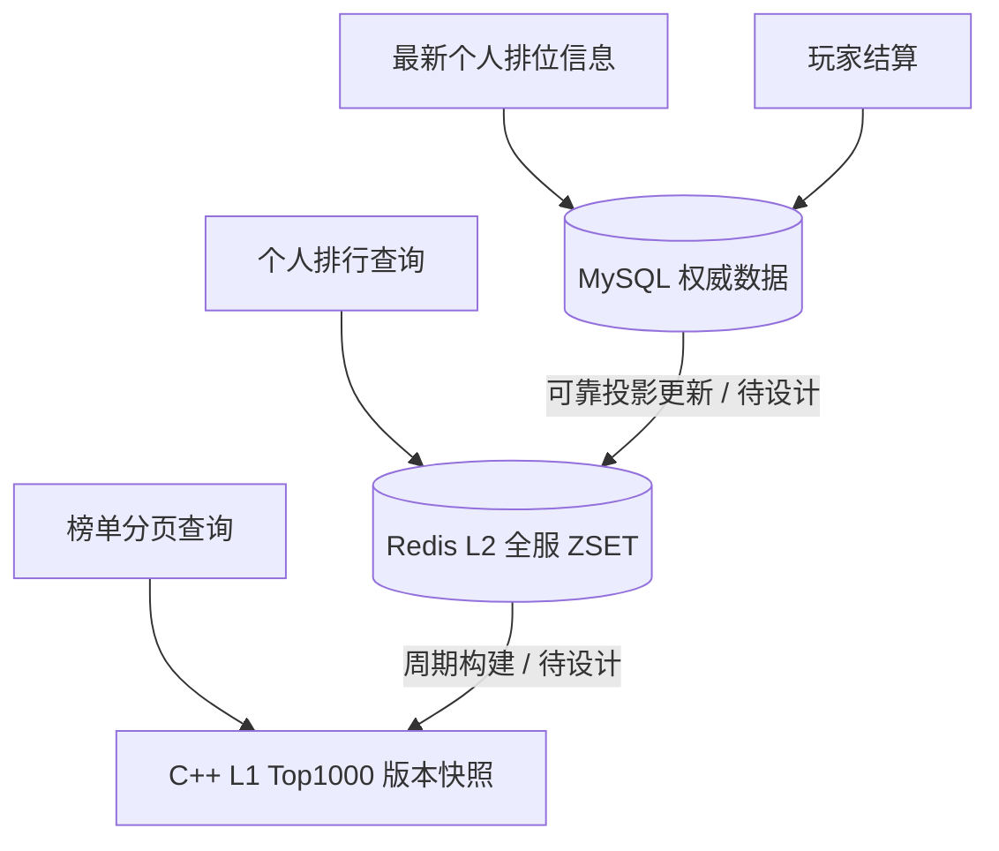

# GameLeaderboard｜技术预研与可行性验证报告

> **文档编号** GL-TR-001 · **版本** V1.0 · **日期** 2026-11-25  
> **状态** 第一轮技术预研收尾；技术选型建议可进入详细设计，系统性能尚未验收  
> **关联需求** [GL-SRS-001 需求规格说明书](01-requirements.md)

## 1. 执行摘要

本项目模拟 MOBA 游戏排行榜模块的企业开发流程。预研目标不是证明某个数据库在所有场景下更快，而是验证数据结构、查询方式和缓存方案是否适合业务，识别实现风险，为详细设计提供证据。

**选型建议：** C++20 后端 + MySQL 8.0 权威存储 + Redis ZSET 全服排行投影 + C++ 本地 Top1000 不可变快照。预研已完成十万级数据构造、导入、存储及数据库命令级测试；C++ 业务服务、最终复合排序全量数据、投影一致性、快照版本管理和百万规模系统压测尚未实现或验证。

| 预研问题 | 证据与结论 | 状态 |
|---|---|---|
| Redis 可否保存十万级全量排行 | 100,016 条，单 ZSET 约 8.42 MiB | 已验证，限测试数据 |
| 能否快速得到个人名次 | ZSET 支持排名；严格大于分值计数测试达到约 2.03 万单客户端 QPS（长测） | 已验证命令级能力；非最终接口 |
| Top1000 是否适合每次直接查 Redis | 单客户端约 1,187–1,204 QPS；大返回量及并发下延迟明显增长 | 已观察 |
| 多条件排序能否编码到 ZSET | 45-bit 方案在整数精度范围内；2^53 附近精度现象已验证 | 数学可行；完整实现待测 |
| 能否减少热点榜单开销 | L1 不可变快照 + 分页，减少重复获取整榜 | 设计候选，未测 |
| MySQL 与 Redis 如何分工 | 权威事务数据与可重建排行投影 | 设计决策，端到端待验证 |
| 100 万、6,000 查询 QPS、250 结算 QPS 能否达成 | 当前无系统级证据 | 待验收 |

## 2. 实验环境与可复现性

| 项目 | 记录值 |
|---|---|
| 云主机 | 阿里云 ECS，Ubuntu 22.04，2 vCPU，约 1.6 GiB 可用物理内存，2 GiB swap |
| 部署 | Docker 单主机；数据库与工具同机，非跨主机真实网络 |
| MySQL | 8.0.27；容器上限 768 MiB；InnoDB buffer pool 128 MiB；max_connections=50 |
| Redis | 6.2；容器上限 256 MiB；maxmemory=128 MiB；noeviction；AOF 开启，appendfsync=everysec |
| MySQL 持久化基线 | innodb_flush_log_at_trx_commit=1；sync_binlog=1；log_bin=ON |
| 测试工具 | mysqlslap、redis-benchmark、redis-cli、EXPLAIN ANALYZE、Performance Schema、docker stats、进程观察 |
| 预研时间 | 2026-11-24 至 2026-11-25 的项目实验记录 |

容器均通过本机访问，MySQL 初始测试使用默认本地连接（未显式指定协议），Redis 基准使用 TCP。测试记录来自当时终端输出与讨论汇总；本文不是完整原始日志归档。工具版本、全部主机硬件细节、内核参数、精确采样窗口及每轮原始日志未完整留存。文档刻意省略真实公网地址、密码等部署信息。复现前应在独立测试环境运行，不得直接修改生产数据或持久化配置。

## 3. 数据模型与测试数据（PoC）

MySQL 使用 `game.players`，不是最终业务 Schema：

```sql
CREATE TABLE players (
    uid INT PRIMARY KEY AUTO_INCREMENT,
    nickname VARCHAR(32) NOT NULL,
    score INT NOT NULL DEFAULT 0
);
CREATE INDEX idx_score_nickname ON players(score, nickname);
```

共 100,016 行，部分手工数据加随机积分（0–5000）；UID=1 的基准积分为 2000。测试积分范围与最终业务 0–735 不同。Redis `leaderboard` 使用 UID 字符串为 member、原始整数积分为 score；此处 UID 未统一补零，也未采用复合 score，故不能用这批数据证明最终四级排序正确性。

### 3.1 批量导入

以下为已执行命令的脱敏复现形式：

```bash
read -s -p 'MySQL password: ' MYSQL_PWD; echo
docker exec -e MYSQL_PWD="$MYSQL_PWD" mysql \
  mysql -u root -D game -N -B -e 'SELECT uid, score FROM players;' > players.tsv
unset MYSQL_PWD

time awk '{printf "*4\r\n$4\r\nZADD\r\n$11\r\nleaderboard\r\n$%d\r\n%s\r\n$%d\r\n%s\r\n", length($2), $2, length($1), $1}' players.tsv | docker exec -i redis redis-cli --pipe
```

| 项目 | 观测结果 |
|---|---:|
| TSV 行数 | 100,016 |
| 文件大小 | 约 1.1 MiB（终端近似显示） |
| Pipeline 导入耗时 | 0.598 s |
| Redis 回复 / 错误 | 100,016 / 0 |
| ZCARD leaderboard | 100,016 |
| OBJECT ENCODING leaderboard | skiplist |
| MEMORY USAGE leaderboard SAMPLES 0 | 8,831,392 B ≈ 8.42 MiB |

Pipeline 减少逐条请求往返开销，不代表命令组成一个原子事务。上述导入只用于预研；生产重建还需处理导入期间并发更新、失败重试和版本切换。

### 3.2 ZSET 内存与编码观察

| 数据 | 编码 / 内存 |
|---|---|
| test_zset：128 个 member | ziplist，813 B |
| test_zset：129 个 member | skiplist，13,200 B |
| test_zset：10,000 个 member | skiplist，917,448 B |
| leaderboard：100,016 个 member | skiplist，8,831,392 B |

Redis 6.2 的测试观察与当时配置下 128 项、64 字节 member 的紧凑编码阈值相符。大 ZSET 由字典与跳表协同维护；跳表 span 可辅助排名统计。删除元素后不会据此假设立即自动降级为 ziplist。不同 Redis 版本内部编码可能不同。

按当前样本线性估算，100 万个 member 单 ZSET 约 84 MiB；**仅为粗略外推，不是实测**。固定宽度 UID、其他 Key、分配器碎片、AOF 重写/复制等均会影响总内存。当前 Redis 128 MiB maxmemory 和主机资源不应直接当作百万规模生产规格。

## 4. 个人排名查询预研（E-01）

### 4.1 实验语义及 SQL 计划

为尽量对齐语义，主要对比严格大于积分 2000 的玩家数量：

```sql
SELECT COUNT(*) + 1 FROM players WHERE score > 2000;
EXPLAIN ANALYZE SELECT COUNT(*) + 1 FROM players WHERE score > 2000;
```

```redis
ZCOUNT leaderboard (2000 +inf
ZREVRANK leaderboard 1
ZSCORE leaderboard 1
```

- MySQL 与 Redis ZCOUNT 的匹配数均为 59,991；严格大于分值的竞争排名为 59,992。
- `ZREVRANK leaderboard 1` 实测为 60,003（从 0 开始），同分 member 排序造成差异；最终业务使用唯一顺序排名，应以复合 score + 固定宽度 member 的 `ZREVRANK + 1` 为准。
- MySQL EXPLAIN ANALYZE 实测约 18.242 ms，扫描约 59,991 条匹配索引记录。普通 MySQL B+ 树索引可以快速定位范围边界，但精确 COUNT 仍需处理匹配记录及可见性，不能把它等同于带 span 的顺序统计结构。

### 4.2 MySQL 并发测试（每轮共 1000 请求）

| 并发客户端 | 耗时 s | QPS（总请求/耗时） |
|---:|---:|---:|
| 1 | 26.425 | 37.84 |
| 2 | 11.532 | 86.72 |
| 5 | 11.583 | 86.33 |
| 10 | 11.638 | 85.93 |

观测到容器 CPU 约 196.86%、内存约 433.9 MiB，块 I/O 未见明显变化。2 核环境下吞吐未随并发持续增长，CPU 可能为该范围计数负载的重要限制。不能把单次容器快照当成完整火焰图或排除所有其他因素。

### 4.3 Redis ZCOUNT 测试

```bash
docker exec redis redis-benchmark -c 1 -n 1000 ZCOUNT leaderboard '(2000' +inf
for c in 1 2 5 10 50 100; do
  docker exec redis redis-benchmark -c "$c" -n 1000000 -q ZCOUNT leaderboard '(2000' +inf
done
```

短测（c=1, n=1000）：16,666.67 QPS；avg 0.052 ms，P50 0.039 ms，P95 0.119 ms，P99 0.311 ms，max 1.207 ms。

长测（每档 n=1,000,000）：

| 并发客户端 | QPS | P50 ms |
|---:|---:|---:|
| 1 | 20,316.94 | 0.039 |
| 2 | 35,527.77 | 0.047 |
| 5 | 69,676.70 | 0.047 |
| 10 | 72,223.02 | 0.079 |
| 50 | 64,238.45 | 0.383 |
| 100 | 54,188.79 | 0.911 |

本轮最大观测吞吐出现在 c=10；继续增加并发时延迟升高、吞吐下降。该点不是通用 Redis 并发最优值。Redis 数据结构的预期复杂度为 ZCOUNT/ZREVRANK O(log N)、ZCARD O(1)，ZSCORE 平均 O(1)（大 ZSET）；命令级结果不能直接作为最终个人排名 HTTP 接口的 QPS。

## 5. Top1000 查询与返回规模预研（E-02）

```sql
EXPLAIN ANALYZE SELECT uid, score FROM players ORDER BY score DESC LIMIT 1000;
```

```redis
ZREVRANGE leaderboard 0 999 WITHSCORES
```

MySQL 查询可沿覆盖二级索引逆序扫描并提前停止，无需扫描全表或额外排序；EXPLAIN ANALYZE 的 LIMIT 实际约 0.053–0.405 ms，索引扫描约 0.052–0.347 ms（1000 行）。Redis 从有序结构获取前 K 个 member，返回成本随 K 增长。两者返回 UID 和 score，而同分顺序未完全对齐；不等价于最终包含头像、昵称、段位及胜率的接口。

| c=1, n=1000 | MySQL | Redis |
|---|---:|---:|
| 总耗时 | 8.232 s | 约 0.84 s |
| QPS | 121.48 | 1,186.24 |
| avg / P50 / P95 / P99 / max（ms） | 未记录 | 0.620 / 0.607 / 0.719 / 0.999 / 1.359 |

### 5.1 Redis Top1000 并发扫描（各档 n=10,000）

| 并发客户端 | QPS | P50 ms |
|---:|---:|---:|
| 1 | 1,204.24 | 0.599 |
| 2 | 1,230.77 | 1.151 |
| 5 | 1,190.05 | 3.343 |
| 10 | 1,146.39 | 7.095 |
| 50 | 1,101.81 | 37.663 |
| 100 | 1,095.53 | 75.135 |

c=1、n=30,000 复测：1,191.04 QPS，P50 0.607 ms。该结果与前两次量级一致。并发扫描显示增加客户端未改善整榜吞吐，且明显增加延迟。

### 5.2 返回条目数扫描（c=1，各 n=10,000）

```bash
for k in 1 10 100 500 1000; do
  docker exec redis redis-benchmark -c 1 -n 10000 -q ZREVRANGE leaderboard 0 $((k-1)) WITHSCORES
done
```

| 返回 K | QPS | P50 ms |
|---:|---:|---:|
| 1 | 20,746.89 | 0.039 |
| 10 | 18,621.97 | 0.047 |
| 100 | 8,312.55 | 0.095 |
| 500 | 2,418.38 | 0.311 |
| 1000 | 1,187.37 | 0.607 |

Top500 与 Top1000 的记录吞吐约 121 万与 119 万条/秒，说明返回规模与端到端处理成本高度相关。不能仅凭此断言瓶颈位于跳表遍历、RESP 编码、TCP 传输或客户端解析中的某一个环节。

### 5.3 资源观察

| 指标 | Redis 空闲 | Top1000 负载 |
|---|---:|---:|
| 容器 CPU | 0.12% | 101.33% |
| 容器内存 | 17.64 MiB | 19.04 MiB |
| NET I/O（显示值） | 2.41 kB / 126 B | 同值 |
| BLOCK I/O（显示值） | 17.9 MB / 9.16 MB | 同值 |

进程采样：redis-server / redis-benchmark 分别约 39.7% / 17.7%，另一时刻 71.4% / 27.9%。工具和服务位于同容器，容器 CPU 不能直接归因给 Redis 主线程；容器 NET I/O 不包含全部 loopback 流量。未进行独立客户端、网络采样或 profiler 分析，瓶颈只定位到测试链路层面。

**设计影响：** 采用 L1 整榜快照、面向客户端返回 20 条分页数据。无需继续追逐命令级 Top1000 QPS 上限，真实服务实现后再做针对性端到端分析。

## 6. 积分更新与持久化预研（E-03）

### 6.1 实际执行与结果

两边均以 UID=1 为更新对象、初始积分 2000，单客户端执行 1000 次加 1。测试改变真实 PoC 数据，不是最终结算事务；已安排恢复初始积分与持久化基线。

```bash
docker exec redis redis-benchmark -c 1 -n 1000 ZINCRBY leaderboard 1 1
docker exec redis redis-cli ZSCORE leaderboard 1

docker exec -it mysql mysqlslap -u root -p --create-schema=game --no-drop \
  --concurrency=1 --number-of-queries=1000 --iterations=1 \
  --query='UPDATE players SET score = score + 1 WHERE uid = 1;'
```

| 实验组 | 持久化参数 | 耗时 s | QPS |
|---|---|---:|---:|
| Redis ZINCRBY | AOF everysec | 约 0.057（工具显示 0.06） | 17,543.86 |
| MySQL UPDATE | redo=1, binlog=1 | 8.990 | 111.23 |
| MySQL UPDATE（放宽刷盘） | redo=2, binlog=0 | 8.062 | 124.04 |

Redis 写入延迟 avg 0.051 ms、min 0.024、P50 0.039、P95 0.071、P99 0.215、max 5.015 ms；ZSCORE 实际返回 3000。MySQL 放宽刷盘后本轮吞吐仅提高约 11.5%，与预期的数量级提升不符。单轮测试且未保存调参后的变量查询，不能从此量化两个日志各自的开销。

已观察到恢复 MySQL 全局参数的成功响应（两个值均 SET GLOBAL 为 1）；Redis `ZADD leaderboard 2000 1` 返回 0（更新已有 member）。MySQL 玩家积分恢复步骤已发出，未留存最终 SELECT 校验；复测前应检查两端基准数据与参数。禁止将放宽持久化策略当作本项目的正式优化。

### 6.2 异常排查（E-04）

| 实验 | 结果 |
|---|---|
| mysqlslap `SELECT 1;`（默认连接） | 1000 次，6.967 s，143.53 QPS |
| Performance Schema `SELECT ?` digest | COUNT_STAR=1000，AVG_TIMER_WAIT=0.0235 ms（已转换单位） |
| mysqlslap `SELECT 1;`（显式 TCP 127.0.0.1） | 1000 次，5.761 s，173.58 QPS |

```sql
SELECT DIGEST_TEXT, COUNT_STAR,
       ROUND(AVG_TIMER_WAIT / 1000000000, 4) AS avg_ms
FROM performance_schema.events_statements_summary_by_digest
WHERE DIGEST_TEXT = 'SELECT ?';
```

外部基准摊销耗时 6.967 ms/请求，而 digest 平均服务端计时约 0.0235 ms，两者计时范围不同，无法直接相减得到精确的网络时延或客户端 CPU 时间。TCP 复测仍存在显著差距。具体原因未定位，不能断言是 mysqlslap 缺陷、网络或服务器性能问题。

原始对比可如实保留，但**不得作为正式性能提升结论**：

| 单客户端短测 | MySQL QPS | Redis QPS | 观测比值（不用于性能承诺） |
|---|---:|---:|---:|
| 严格大于积分计数 | 37.84 | 16,666.67 | 约 440× |
| Top1000 | 121.48 | 1,186.24 | 约 9.76× |
| 积分加 1 | 111.23 | 17,543.86 | 约 158× |

理由：工具与协议不同、计时边界不同、持久性不同、部分同分语义不同、重复轮次不足、真实结算还包含多字段与幂等记录等操作。尤其禁止在简历或 README 中直接宣称「系统性能提升 440 倍/158 倍」。

**处置决策：** 本阶段停止追查 mysqlslap 特定异常，因为不影响采用 Redis 排名结构的业务与算法依据。详细设计/实现之后，使用统一的负载工具和实际服务接口重新测量。此决策体现预研范围控制，而非把异常视为已修复。

## 7. 技术方案论证（设计候选，未实现）

### 7.1 数据职责与访问路径（TD-01）



- MySQL：玩家排位状态、赛季、比赛结算记录、历史归档；权威持久化和事务。
- Redis：全量排行投影及高效名次查询，避免每次请求执行大量索引范围计数；可依据权威数据重建。
- L1：只保存 Top1000 的不可变快照及其版本管理候选，不缓存所有玩家。
- 图示为初步访问路径；页面底部个人排名是否必须与榜单同版本仍是 SRS Q-01。不能假设来自不同层的数据天然一致。

备选方案：只用 MySQL 可减少一致性工程复杂度，但普通精确范围计数不利于大量个人排名查询；只缓存 Top1000 无法直接解决榜外用户精确名次；Redis 单独作为权威不满足当前可靠性取舍。选择组合架构是为了匹配读写职责，不意味着每种场景 Redis 都更快。

### 7.2 四级排序的复合编码（TD-02）

Redis ZSET score 为 double；整数精确表示的安全范围使用 0 至 2^53−1。预研验证了 2^53 与 2^53+1 转为 double 后无法区分。采用如下候选布局：

| 字段 | 范围 | 位数 | 位区间 | 排序转换 |
|---|---|---:|---|---|
| 积分 | 0–735 | 10 | 44–35 | 原值 |
| 胜率编码 | 0–1000 | 10 | 34–25 | 百分数保留 1 位后乘 10 |
| 时间编码 | 0–31,536,000 | 25 | 24–0 | 31,536,000 − elapsed_seconds |

```text
高位                                       低位
[ 积分 10 bit ][ 胜率 10 bit ][ 反向时间 25 bit ]
```

```cpp
// 设计示例：真实实现必须先检查各字段范围。
constexpr std::uint64_t pack(std::uint64_t score,
                             std::uint64_t win_rate_code,
                             std::uint64_t time_code) {
    return (score << 35) | (win_rate_code << 25) | time_code;
}
```

45 bit < 53 bit，保留 8 bit 精度预算；高优先级字段任意单位差值均大于全部低优先级位的可表示差值。时间越早，反向编码越大，符合 ZREVRANK 降序。时间参考点为赛季开始，赛季正常约三个月；最长 365 天和跨赛季尾部结算是否越界须按 Q-03 确认。胜率应使用实际胜场/总场次进行确定性舍入，而不是累加历史浮点胜率；零场不入榜。

备选混合进制编码：`(score * 1001 + win_rate_code) * 31536001 + time_code`，也能维持优先级，最大值仍在 45 bit 范围。当前优先选位打包；最终需测试边界值、解码、溢出、非法输入和排序性质。

UID 作为固定宽度的十进制字符串 member，字典序与数值序一致；ZREVRANK 对同 score 采用 member 逆字典序，实现 UID 降序，无需反转 UID。固定宽度由最终 UID 类型决定，尚未定稿。完整业务编码未在当前 100,016 条数据上部署。

### 7.3 C++20 不可变快照（TD-03）

早期候选：互斥锁包围刷新和读取；改进候选：锁外构建、锁内 swap；再比较 shared_mutex 多读单写及返回值/引用生命周期。当前倾向使用 C++20 `std::atomic<std::shared_ptr<const Snapshot>>`。

```cpp
// 设计示意，非已编译或已部署的项目代码。
using Snapshot = std::vector<Player>;
class LeaderboardCache {
    std::atomic<std::shared_ptr<const Snapshot>> snapshot_;
public:
    LeaderboardCache()
        : snapshot_(std::make_shared<const Snapshot>()) {}
    std::shared_ptr<const Snapshot> get() const {
        return snapshot_.load();
    }
    void refresh() {
        auto next = std::make_shared<const Snapshot>(queryRedis());
        snapshot_.store(next);
    }
};
```

刷新在发布前构造完整数据，读取获取 shared_ptr 而非复制整个 vector；旧快照由现有读者继续持有，最后一份引用释放时回收。原子化的是 shared_ptr 发布/获取，并非允许并发修改 vector；快照不得保留可写别名。标准不保证 atomic shared_ptr 无锁，因此不能宣称已实现 lock-free 缓存。

最初候选刷新间隔为 1 秒，需求现为正常端到端投影时效 ≤3 秒；实际刷新周期应给 Redis 更新、读取和发布留出预算。假设 5 个实例各每秒刷新一次，共 5 次/秒整榜拉取，这是理论估算，不是实测降载比例。

**新增要求：** 5 分钟快照分页。上述单指针只能保证单次读操作生命周期，无法保证跨 HTTP 请求或跨实例复用相同版本。需另外设计有界版本存储、快照 ID、过期与跨实例访问。以 1 秒生成一版为例，5 分钟可能产生约 300 个历史版本（另有边界和正在使用的引用），每个版本最多 1000 条；具体内存与对象分配必须实测。刷新失败不应破坏已发布的完整快照；降级策略需遵循时效承诺并暴露错误/滞后。

### 7.4 事务、幂等与数据一致性（TD-04）

候选事务设计（概念 SQL，非当前 PoC 表或最终 Schema）：

```sql
START TRANSACTION;
-- UNIQUE(match_id, uid) 约束保障业务幂等；实际字段、结果与版本待设计。
INSERT INTO match_records (...) VALUES (...);
UPDATE player_season_stats SET ... WHERE ...;
COMMIT;
```

同一事务写入结算记录及权威排位状态；任一步失败回滚，避免仅写入幂等标记却没有发放积分。并发重复提交依赖数据库唯一约束及事务；若首次请求尚未提交，竞争请求可能等待，其结果取决于首次事务提交/回滚及锁超时/死锁等情况。重复请求返回原始业务结果，不能用后来变化的玩家当前积分冒充原结果。

MySQL 保持预研的强持久化配置（redo=1、binlog=1）。Undo Log 支撑回滚及 MVCC，Redo Log/WAL 支撑崩溃恢复，Binlog 用于复制/时间点恢复等；提交时同步日志与数据页最终落盘是不同过程。实际可靠性还依赖存储、复制、备份和故障模型。Redis AOF everysec 存在已确认缓存写入的丢失窗口，因此 Redis 不承担比赛结算的最终权威责任。

复合 score 应由原始状态计算后绝对写入，不能照搬预研 ZINCRBY。多个结算可能发生投影乱序；MySQL 提交成功但 Redis 更新失败也必须可恢复。可在详细设计中比较事务内 outbox + 异步投影（版本检查、重试）、同步写入 + 补偿等方案，现阶段不宣称已选定或实现。Redis 重建期间的增量追赶、归档前的最终一致性和旧赛季写入栅栏均需设计及测试。

## 8. 风险与后续验证计划

| ID | 风险 / 缺口 | 后续验证或缓解 | 优先级 |
|---|---|---|---|
| R-01 | 旧快照与个人实时排名版本不一致 | 完成需求 Q-01，验证页面一致性 | P0 |
| R-02 | MySQL/Redis 投影丢失、乱序、重复 | 事务、版本化写入、故障重试、重建与对账 | P0 |
| R-03 | 快照多版本导致内存增长、跨实例分页失败 | 明确版本路由与 TTL，测试过期、并发、内存 | P0 |
| R-04 | 最终编码及时间边界未验证 | 编解码/排序性质测试、固定 UID 宽度、赛季边界 | P0 |
| R-05 | 百万玩家容量、6,000/250 QPS 未实测 | 完整系统统一压测，明确环境及混合负载 | P0 |
| R-06 | mysqlslap 基线异常 | 保留异常记录，后续统一测试工具，必要时定位 | P1 |
| R-07 | Top1000 返回链路瓶颈未隔离 | 按真实服务热点与资源监控决定是否 profiler 深挖 | P1 |
| R-08 | 赛季长期处于结算中、归档中断 | 状态机、恢复机制、跨服务确认 | P0 |

### 后续系统验证路线（尚未执行）

1. 详细设计评审：API、Schema、Redis Key、事务及投影、快照分页、连接池、并发模型、赛季归档、监控和部署。
2. 单元/属性测试：四级排序、精度、边界积分、百分比、继承、并发幂等。
3. 集成测试：真实 MySQL/Redis 容器与模拟对局服务，验证成功/失败/重试/乱序、归档与历史查询。
4. 性能测试：统一 HTTP 负载客户端，100 万入榜玩家；分别测读、写、混合负载。建议初始查询配比 5:2（榜单与个人排名），随后依据 API 设计修正；记录 P50/P95/P99、成功吞吐、错误率、CPU、内存、缓存命中与投影时效。查询 6000 QPS 与结算 250 QPS 为目标，不要求当前单台预研主机无条件达成。
5. 故障测试：服务重启、Redis 断连/数据丢失、结算响应丢失、归档任务中断等；根据明确的故障模型验证恢复和已确认结算不丢失。
6. 发布与交付：版本化配置、自动化测试、部署指南、可复现负载脚本、真实日志及监控图；报告区分运行结果、推论及未通过项。

## 9. 决策记录与阶段结论

| 决策编号 | 决策 | 状态 |
|---|---|---|
| TD-01 | MySQL 权威 + Redis 全量 ZSET + L1 热点快照 | 选型建议已形成，系统未实现 |
| TD-02 | 45-bit score + 固定宽度 UID | 数学设计已形成，最终编码待验证 |
| TD-03 | C++20 不可变快照、版本化分页 | 候选实现；并发与生命周期待测 |
| TD-04 | 单玩家事务结算与业务唯一键幂等 | 候选实现；投影可靠性方案待定 |
| TD-05 | 停止本轮 mysqlslap 深挖，百万级实验延至系统测试 | 预研范围调整已确认 |

本轮预研达到「技术路线具有可行性、关键风险得到识别」的阶段目标；没有达到「完整系统通过性能和可靠性验收」的阶段。下一阶段应围绕需求编号完成详细设计和评审，避免为了漂亮的跑分继续无边界调研。后续新增结果以版本化实验报告及原始日志保存，不覆盖或美化本轮异常数据。

## 附录 A：复现命令索引

以下命令仅用于现有 PoC 数据；正式压测应构建隔离测试库和独立 Redis Key，避免修改共享基准数据。

```bash
# MySQL 个人排名短测（改变 concurrency 即可复测）
docker exec -it mysql mysqlslap -u root -p --create-schema=game --no-drop \
  --concurrency=1 --number-of-queries=1000 --iterations=1 \
  --query='SELECT COUNT(*) + 1 FROM players WHERE score > 2000;'
# MySQL Top1000
docker exec -it mysql mysqlslap -u root -p --create-schema=game --no-drop \
  --concurrency=1 --number-of-queries=1000 --iterations=1 \
  --query='SELECT uid, score FROM players ORDER BY score DESC LIMIT 1000;'
# Redis Top1000 并发测试
for c in 1 2 5 10 50 100; do
  docker exec redis redis-benchmark -c "$c" -n 10000 -q ZREVRANGE leaderboard 0 999 WITHSCORES
done
# Redis 内存与数据核验
docker exec redis redis-cli ZCARD leaderboard
docker exec redis redis-cli OBJECT ENCODING leaderboard
docker exec redis redis-cli MEMORY USAGE leaderboard SAMPLES 0
docker exec redis redis-cli ZSCORE leaderboard 1
# MySQL 基线验证（进入 mysql 客户端后执行对应 SQL）
```

```sql
SELECT uid, score FROM game.players WHERE uid=1;
SHOW VARIABLES LIKE 'innodb_flush_log_at_trx_commit';
SHOW VARIABLES LIKE 'sync_binlog';
SHOW VARIABLES LIKE 'log_bin';
```

复现实验应同时记录日期、commit、命令、工具版本、数据校验、环境、参数、全部输出、重复轮次及异常。当前报告引用的是已留存的观察值和当时讨论汇总，不虚构不存在的原始日志、截图或测试脚本。
